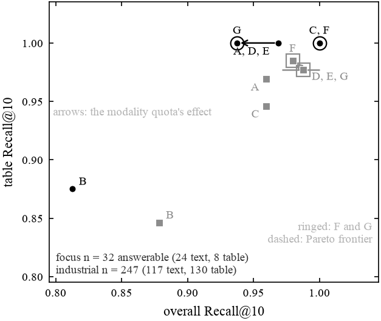
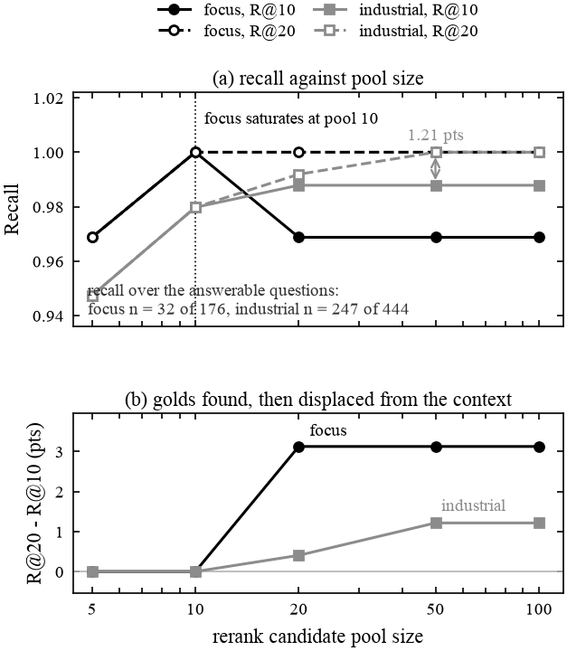
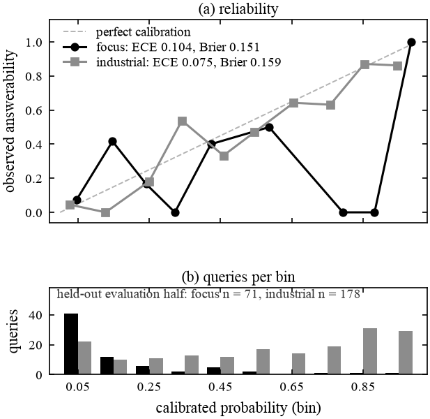
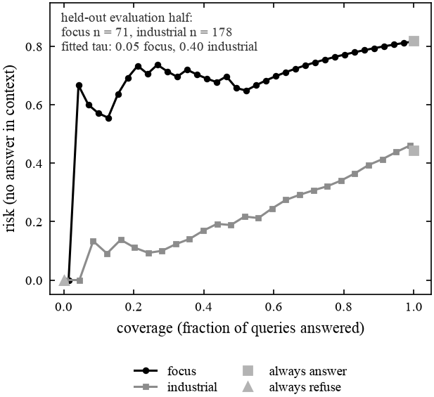
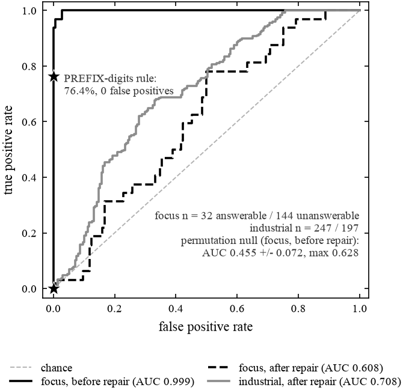
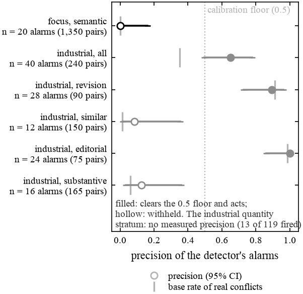

# Abstract

Retrieval-augmented generation (RAG) is now deployed in industry on documentation that public
benchmarks never touch: standard operating procedures, failure-mode analyses, calibration
records, equipment manuals. This report asks one narrow question and answers it with
measurements. When a RAG generator is handed industrial text, can a gate in the code decide
whether the retrieved evidence actually contains the answer? And what is that gate worth once
you measure it?

The framework adds four mechanisms to a hybrid retrieval stack: category pre-filtering and
reciprocal-rank fusion of a lexical and a dense leg, a cross-encoder reranker with a modality
quota, a calibrated confidence gate over the answer-in-context detectability of the candidate
pool, and a contradiction gate over the retrieved set. Every number in this report is tied to
an archived result file. The evaluation runs on a supply-chain-management corpus of
735 chunks from 14 documents, and on a cross-category
industrial corpus of 2383 chunks from 46 documents. Each has a
hand-built benchmark of answerable and unanswerable questions.

Three findings carry the report. The framework's own hypothesis, that a non-bypassable
code-level gate lowers the rate of answering unanswerable questions, comes out
**supported under both prompt conditions**. One generator sat behind five arms, the prompt condition was varied
as an experimental axis, and every comparison used a paired exact McNemar test. Second, the
confidence score does not buy a lower answer rate on unanswerable questions. A
random-escalation control refuses just as many, and more, by luck. What the score buys is
**precision of refusal**. The gate spends 2 refusals on answerable
questions; the random control spends 11. Third, and against the
framework's own preferred reading, the contradiction gate's precision against reader labels
came out at **0.0%** (20 labelled alarms, 95% upper
bound 16.1%). It is reported as unconfirmed rather than as a working
detector.

The benchmark had to be repaired twice before its numbers meant anything. An audit of the
answer labels found a defect in the benchmark itself. The unanswerable class turned out to be
separable from the answerable class using the question text alone (ROC AUC
0.999). Both repairs count as contributions, because each one changes what the
headline number means. What this study adds is **a five-stage evidence-grounded framework
for industrial RAG**: hybrid retrieval under a category pre-filter, a modality quota across
text, tables and charts, a confidence gate that generation cannot bypass, contradiction
surfacing, and per-claim evidence tags. Alongside it is the **cost-coverage-reliability
frontier** measured for that framework on industrial text, at the level of the individual
answer claim, on a corpus regime that is not the procedural one every earlier deployment
uses.

**Keywords:** retrieval-augmented generation; confidence gating; abstention; calibration;
hybrid retrieval; reciprocal rank fusion; contradiction detection; industrial decision support;
evaluation methodology.

# 1. Introduction

## 1.1 The problem

A retrieval-augmented generator reads a corpus and answers a question. In industry the corpus
is not a wiki. It is a controlled set of documents somebody signed off on, and the questions
are not open-domain curiosity. They are operational decisions: whether a part's tolerance is
acceptable, which step of a procedure applies, what a specification requires.

Such a corpus gives the system one property that dialogue and open-domain benchmarks never
test. **A wrong answer and a non-answer do not cost the same.** A refusal costs a supervisor
five minutes. A confidently fabricated tolerance costs a scrapped batch.

So this report does not ask whether RAG works. It asks whether the component that decides
*to answer* can be measured at all, and what that decision is worth once it has been measured
properly.

## 1.2 Motivation

Two facts drove this work, and neither of them is comfortable for the field.

The first is that the mechanisms now standard in RAG systems, a confidence threshold, an
abstention option, a contradiction check, get evaluated by their intended behaviour rather
than their measured behaviour. Someone picks a threshold of 0.5. The system refuses some
questions. A refusal rate gets reported. But the question a practitioner needs answered is
different. Given a refusal budget, *how many of those refusals land on the questions that
should have been refused?* That is a precision question, and it cannot be answered without a
control arm that refuses the same number of questions while ignoring the confidence signal
completely.

The second fact is that the benchmarks used to measure abstention can carry their own answer.
A benchmark whose unanswerable half is easy to separate from the answerable half measures the
benchmark, not the system. This report found exactly that defect in its own benchmark, and
repairing it moved the headline refusal rate by a factor of nearly four.

## 1.3 Research objectives

The work runs on four research objectives.

**RO1: Build an evidence-grounded retrieval-augmented generation framework for industrial
decision support.** Generation is gated in code, not by convention. The generator is called at
exactly one point in the pipeline, and only when the gate has accepted.

**RO2: Make the retrieval stage modality-balanced and category-aware.** The retrieval stack
fuses a lexical and a dense leg, reranks with a cross-encoder, and enforces a quota over text,
table and chart chunks.

**RO3: Test the framework's own hypothesis about hallucination.** The claim that a
non-bypassable gate reduces hallucination has to be tested against a generator that is
*required* to answer, not only against one that is allowed to decline. Only the first case
takes the generator's own willingness to refuse out of the picture.

**RO4: Characterise the failure modes.** The framework has to report its own failures,
including the ones that contradict it, with the same care as its successes, and it has to
publish the error rates of the instruments it measures with.

## 1.4 Contributions

The contribution is **a framework, and the measurement of it**.

The framework is a five-stage pipeline that fuses a lexical and a dense leg under a
category pre-filter, balances the result across text, tables and charts, gates generation on
a calibrated posterior over the answer-in-context detectability of the candidate pool, and
tags every claim in the answer with the evidence behind it. The gate is non-bypassable by
construction rather than by convention: the generator is injected into the pipeline and
called at exactly one point, after the gate accepts.

Every mechanism it draws on is published. Reciprocal-rank fusion goes back to Cormack et al.
(2009), the dense retriever to Karpukhin et al. (2020), calibrated abstention to Yadkori et
al. (2024), and the detector closest to this gate to Goswami and Kurra (2025). What is new is
that they are put together into one industrial system and then measured end to end on
industrial text, at the level of the individual answer claim, with the benchmark's own
defects audited and repaired and the negative results reported in the same voice as the
positive ones.

The specific contributions are:

1. **The framework.** A five-stage pipeline that fuses hybrid retrieval under a category
   pre-filter, holds a modality quota across text, tables and charts, gates generation on a
   calibrated answer-in-context posterior, surfaces contradiction between retrieved chunks,
   and tags every claim with its evidence. The gate cannot be bypassed: the generator is
   injected into the pipeline and called at exactly one point, after the gate accepts, and a
   refused question costs no model call at all.
2. **A repaired refusal benchmark with a published shortcut audit.** The unanswerable class
   turned out to be separable from the question text alone (ROC AUC 0.999). It
   was rebuilt with corpus-anchored definitions and structural twins. The repaired class gives
   a refusal rate of 23.6%, against the 91.7% the
   defective class produced.
3. **A two-condition test of the framework's own hypothesis.** The prompt condition is an
   experimental axis, not a fixed setting, and the verdict is supported under both prompt conditions.
4. **A random-escalation control that isolates what the confidence score buys.** The answer
   is refusal precision, not a lower answer rate on unanswerable questions.
5. **A reader-label measurement of the contradiction gate's precision**, which came out at
   0.0%, along with the two detector defects the audit exposed.
6. **A published error profile for the claim scorer**, which is the instrument the
   hallucination metric is computed from.

## 1.5 Scope of the claims

Three boundaries matter here, because they limit what the results mean.

First, the corpus is *industrial-engineering encyclopaedic text*, not practitioner
documentation. The primary corpus, 735 chunks from proprietary
supply-chain documents, cannot be redistributed, so every measurement runs on a public
substitute that ships with its provenance. Claims are narrowed to match.

Second, the generator-side comparison ran on **one** generator. A replication on a second
generator could not be run, because that model returned no text on 24 of 66 questions. One
generator settles the hypothesis for that generator, not in general.

Third, the long-context comparison's quality half was measured on the focus domain only. The
cross-category corpus does not fit a 128K-token context window, so on that corpus the
comparison is settled on cost and coverage alone.

## 1.6 How this report is organised

Section 2 positions the work against the literature. Section 3 specifies the framework and its
four mechanisms formally. Section 4 describes the corpora, the benchmark, its repairs and
the statistical protocol. Section 5 reports the measurements. Section 6 interprets them.
Section 7 states the limitations. Section 8 concludes and sets out the future work. The
reference list comes last.

# 2. Literature Review

## 2.1 Retrieval-augmented generation and the problem of evaluating it

Retrieval-augmented generation was introduced by Lewis et al. (2020) as a way to combine a
parametric model with a non-parametric, updatable index, and Karpukhin et al. (2020) gave it
the form it has in practice: a dense retriever over passages, and a reader that answers from
what the retriever returned. The architecture is routine. What is not routine is the
evaluation.

The literature has since split into three lines. Retrieval can be made **conditional**, so
that the system decides at answer time whether it needs to retrieve at all. It can be made
**active**, so that the query depends on what has been generated so far and on how confident
the model is. It can be made **structural**, so that the corpus is indexed as a graph rather
than as passages. Every one of these lines has made retrieval better, and none of them has
changed what the system is measured on.

The evaluation instruments settled early on two ideas: citation precision and recall, which
ask whether a generated claim is entailed by the passage it came from, and atomic
decomposition, which asks whether each fact in a long answer has support in the source. Both
are necessary and both are insufficient. They measure the quality of what was said, not the
decision to say it at all. A system that answers everything scores perfectly on claim
precision and still fails the deployment it was built for.

## 2.2 Confidence, calibration and abstention

The second thread asks how a system knows what it knows. A line of work establishes that
language models carry informative internal uncertainty, and that the uncertainty which
survives a paraphrase is more useful than the uncertainty that does not.

The abstention literature turns that into a mechanism. Yadkori et al. (2024) frame abstention
as a conformal prediction problem with a coverage guarantee, which is the formal shape of
"answer when the evidence is good enough". Later work makes abstention controllable without
training the model to abstain, and a 2026 result shows that entropy on its own is not enough
for safe selective prediction. A confidence score needs a calibration step and a measurement
of its own error, not a threshold picked by hand.

## 2.3 Sufficiency verification and the risk-coverage frontier

A third thread separates *relevance* from *sufficiency*. Joren et al. (2024) introduce
"sufficient context" as a lens on RAG systems and show that answer accuracy is conditional
on the context being sufficient rather than merely present. Later work makes sufficiency an
explicit verification target and reports risk at coverage, and a 2026 result reaches for a
formal object: a Horn-closure certificate of whether the evidence is *enough*.

The distinction matters for naming, because the literature reserves "sufficiency" for a
set-level property. The label this report uses for its own gate is **answer-in-context
detectability**, with its positive class defined operationally as *the gold chunk is present
in the reranked candidate pool*. Calling that "sufficiency" would claim prior art this report
does not have.

The risk-coverage formulation is the right lens, because it makes the trade explicit. Let
$\hat{y}_c$ be the system's answer at coverage level $c$, and let $L$ be a per-answer loss.

$$
\text{Risk}(c) \;=\; \mathbb{E}\!\left[\, L\!\left(y, \hat{y}_c\right) \,\middle|\, \text{answered} \,\right], \qquad
\text{Coverage}(c) \;=\; \frac{\left|\{q \in Q : \text{answered at level } c\}\right|}{|Q|}.
$$

The operating point of the framework is the pair $(c, \text{Risk}(c))$ it selects. What this
report contributes here is the measurement of that frontier at the level of the individual
answer claim.

## 2.4 The selection effect and recognition-refusal misalignment

Two results from 2026 constrain what a null finding may be reported as. Tikhomirov and
Savchenko (2026) name **the selection effect**: a gate forwards a slice on which the
downstream component is no better than the baseline, which erases the component's advantage.
The same year names **recognition-refusal misalignment**: the model recognises that a question
is impossible, yet fails to route that recognition to an abstention.

Together these mean a cautious-condition null has to be reported as *"the prompt had already
realised the gate's function on that slice"*, and never as *"confidence gating does not
work"*. A companion result sharpens the point from the other side: models systematically
overcommit and rarely abstain, so a single model that abstains is not the general case and a
single-model null cannot support a general claim. A further result shows that abstention can
be a prompt artefact as well as genuine uncertainty, and a two-stage answer-or-abstain
protocol reaches the same conclusion from the protocol side.

## 2.5 Hybrid retrieval, fusion and reranking

The retrieval stack this report builds on is standard: the lexical leg is Okapi BM25, and the
dense leg is a bi-encoder trained for question answering, of the kind Karpukhin et al.
(2020) introduced. Cormack et al. (2009) gave the fusion function that joins them,

$$
S_{\text{RRF}}(d) \;=\; \sum_{r \in \mathcal{R}} \frac{1}{k_{\text{RRF}} + \text{rank}_r(d)},
\qquad k_{\text{RRF}} = 60,
$$

and a later analysis of which fusion functions actually work settled the choice further. The
cross-encoder reranker is equally standard. Two recent papers sit right next to this report's
stack: one pairs hybrid retrieval with a dynamic policy aimed at hallucination prevention,
and one adds specialised knowledge and rationale to the retrieved context rather than
trusting the retriever on its own.

What is not settled is the *placement* of a modality quota relative to the reranker, and the
question this report answers is deliberately narrow. **The ranking differs by corpus**, so
the quota position is a configuration value rather than a universal rule. The
counter-evidence in the literature matters here: retrieval enhancements often stop helping
once a strong reranker is present, which is an argument for a configuration value rather than
a rule.

## 2.6 Contradiction detection in retrieved evidence

The third mechanism looks for contradiction between retrieved chunks, and the literature on
knowledge conflict is large. It measures how models handle conflicting evidence, detects
conflicting sources in search-augmented models, detects inconsistencies across text, tables
and knowledge graphs, and detects corpus-level inconsistencies in Wikipedia. It also shows
that re-rankers have to be optimised for semantic conflict rather than only for topical
similarity.

Two lessons from this thread are applied directly in this report. A detector evaluated
against a ground truth *defined by its own threshold* measures agreement, not precision. And
the phenomenon a contradiction detector looks for has to be actually present in the corpus.
Where it is absent, a high recall is a statement about the corpus rather than about the
detector.

## 2.7 Evaluation practice for abstention

Two benchmark papers set out the desiderata this report adopts. Rajpurkar et al. (2018) argue
that unanswerable questions must be *plausible*. A question with an obviously absent answer
tests nothing. Work on clinical question answering then showed that an n-gram filter
identifying the questions a knowledge base cannot answer invalidates an evaluation of
unanswerability detection, and other work removes size-matched shortcuts from memory
construction and fixes the annotation standard in two well-known inference benchmarks.

Constructing the unanswerable class has its own literature. A benchmark that measures
combined retrieval and parametric knowledge in the same run is the closest published
instrument to the one in this report, and the evaluation of unanswerability in RAG directly
reports the prompt sweep and the coverage metrics this report's protocol resembles. A
cautionary result matters most for a benchmark of this kind: the labeling problem in
hallucination-detection benchmarks is itself an empirical source of error, so the label
standard has to be audited rather than assumed.

## 2.8 Industrial and enterprise RAG

The industrial setting is not empty: the claim that RAG fails in enterprises for reasons
that have nothing to do with the model is well made, and the literature contains
industrial-scale RAG frameworks for requirements engineering on automotive manufacturing data,
a multimodal manufacturing safety chatbot with its own benchmark, an adaptive RAG benchmark
for semiconductor manufacturing, ontology-based knowledge graphs for industrial standards, a
retrieval-confidence layer for enterprise code generation, and a human-in-the-loop cascade
for regulated industries.

The fair summary is that industrial RAG has been *built* far more often than it has been
*measured at the level of the answer claim*, and that the deployed industrial corpora are
regulatory and procedural. This report contributes a measurement on encyclopaedic
industrial-engineering text, and says so.

## 2.9 The gap this leaves

Three things follow from the review. The abstention *mechanism* is established prior art;
Goswami and Kurra (2025) are the closest. The end-to-end *measurement* of it, with a
control arm, on industrial text, is not. The benchmark-level shortcuts that inflate refusal
rates are known, but on the evidence of this literature they have not been reported for a
RAG refusal benchmark. And what a confidence score buys, once the generator is not allowed
to decline on its own, is still an open question.

# 3. System Design and Architecture

## 3.1 Overview

The framework is a five-stage pipeline. A request enters at stage 0. It is either refused
before any retrieval happens, or it passes to stage 1. It leaves at stage 4 as a refusal or as
a set of per-claim annotations.

| Stage | Name | Input | Output | May refuse? |
|---|---|---|---|---|
| 0 | Query-form validation | raw query string | query or refusal | yes |
| 1 | Hybrid retrieval | query | candidate pool of chunks | no |
| 2 | Rerank and quota | candidate pool | final context of 10 chunks | no |
| 3 | Confidence gate | final context | accept or refuse | yes |
| 4 | Generation and claim assessment | accepted context | annotated answer | no |

Two properties of this arrangement explain the architecture, and both belong to the code
rather than to a convention.

**The gate cannot be bypassed.** The generator is not handed to `answer()` by the caller. It
is injected into the framework, and the framework calls it at exactly one line, after the gate
has accepted. On a refusal, the claim assessment and the contradiction detection are skipped
too, so a refused query costs no model call at all. The only paths that skip the gate are the
two comparison arms used by the generation experiment, `rag_nogate` and `long_context`. Both
are named for what they remove, and both are reported as separate results.

**The form validator is a separate component from the gate.** It runs before retrieval, so a
request it refuses costs neither retrieval nor a model call. Section 3.7 explains why the two
must not be merged.

## 3.2 Corpus and chunking

Documents are ingested into chunks, and each chunk records its modality: text, table or
chart. On the supply-chain focus corpus the modality mix is 88.8%% text, with
the remainder split between tables and charts. The mean chunk length in the case study is
101 words. Every chunk carries its source document, its category and its modality, and the chunk
identifier is unique across the corpus, because a duplicated chunk identifier quietly
inflates every recall measurement that counts chunks.

The public corpus ships with its provenance. Each document carries the upstream identifier, a
SHA-256 of the content, the chunk count and the licence. A corpus that cannot be
redistributed is the reason the study runs on a public substitute. A corpus that cannot be
traced is the reason that substitute ships with its provenance attached.

## 3.3 Hybrid retrieval

The lexical leg is Okapi BM25 with parameters $k_1 = 1.2$$ and $b = 0.75$, and
the Robertson-Sparck-Jones IDF variant with a +1 offset:

$$
\text{BM25}(q, d) \;=\; \sum_{t \in q} \text{IDF}(t) \cdot
\frac{f_{t,d}\,(k_1 + 1)}{f_{t,d} + k_1\!\left(1 - b + b\,\frac{|d|}{\text{avgdl}}\right)},
\qquad
\text{IDF}(t) = \ln\!\left(1 + \frac{N - n_t + \tfrac{1}{2}}{n_t + \tfrac{1}{2}}\right).
$$

The dense leg is `BAAI/bge-m3`, a 1024-dimensional multilingual encoder with L2 normalisation,
so that inner product and cosine similarity coincide. Its model card states that it "no longer
requires adding instructions to the queries", so no query prefix is prepended. The previous
general-purpose sentence encoder, `sentence-transformers/all-MiniLM-L6-v2`, is archived under
`research/baseline_minilm/` and its numbers are kept as the `BASE_F_*` tokens, so both sides
of the encoder comparison rest on measured values rather than recollection.

The two legs are fused by reciprocal rank fusion over the top 20 of
each leg:

$$
S_{\text{RRF}}(d) \;=\; \sum_{r \in \mathcal{R}} \frac{1}{k_{\text{RRF}} + \text{rank}_r(d)},
\qquad k_{\text{RRF}} = 60,
$$

where $\mathcal{R}$ is the set of ranked lists the chunk appears in, and $\text{rank}_r(d)$ is
its rank in list $r$. A chunk that is absent from a list contributes nothing. The fused pool
of 50 candidates goes to the cross-encoder.

A category pre-filter restricts *both* legs to the categories in scope, before fusion. That is
enforced as an invariant rather than left to convention: the filter restricts each leg
independently, the reranker only permutes its own pool, and the quota never leaves its pool.

## 3.4 Reranking and the modality quota

The cross-encoder `cross-encoder/ms-marco-MiniLM-L6-v2` scores the fused pool, and the top
10 form the final context. The reranker permutes. It does not change
membership, and the invariant suite asserts that too.

The modality quota is a **floor** on the share of non-text chunks in the final context, not a
ceiling on text. Writing $\mathcal{C}$ for the candidate pool and $n_m$ for the number of
candidates of modality $m$, the quota requires the final context to hold at least

$$
q_m \;=\; \min\!\left(n_m,\; \left\lceil \alpha_m \cdot |\mathcal{C}| \right\rceil\right)
$$

chunks of modality $m$, with $\alpha_{\text{table}} = 0.15$ and
$\alpha_{\text{chart}} = 0.05$. When the pool cannot supply the floor, the floor is relaxed
rather than invented. Extra candidates are pulled to depth 10 per modality, and
if the pool still cannot supply them, the quota yields.

**Where the quota applies is a configuration value**, `modality.position`, defaulting to
`pre_rerank`. It is not a rule, and Section 5 reports the measurement that shows why.

## 3.5 The confidence gate

This is the mechanism the report is about. The gate asks a query-level question: does the
retrieved context contain evidence the question can be answered from? It is calibrated, it
has a threshold, and it is the only thing standing between a bad question and a generated
answer.

The gate's feature vector is built from five query-level statistics of the retrieved pool:

$$
\phi(q) \;=\; \left[\, s^{(1)}_{\text{rerank}},\; \bar{s}^{(3)}_{\text{rerank}},\; s^{(1)}_{\text{bm25}},\; \max_d S_{\text{RRF}}(d),\; |\{d \in \mathcal{C} : s_{\text{rerank}}(d) > \beta\}|\, \right],
$$

namely the top reranker score, the mean of the top three reranker scores, the top BM25 score,
the maximum fused RRF score, and the number of candidates above the reranker's relevance bar.
The vector is standardised with the calibration split's mean and standard deviation, and
mapped to a posterior by a logistic model, Platt's form, whose weights are fitted by maximum
likelihood on held-out labels:

$$
p_{\text{conf}}(q) \;=\; \sigma\!\left(\beta_0 + \boldsymbol{\beta}_1^{\mathsf{T}}
\frac{\phi(q) - \boldsymbol{\mu}}{\boldsymbol{\sigma}}\right),
\qquad
\sigma(z) \;=\; \frac{1}{1 + e^{-z}} .
$$

The decision rule is a threshold on that posterior:

$$
\text{accept}(q) \;=\; \mathbf{1}\!\left[\, p_{\text{conf}}(q) \ge \tau \,\right],
$$

with the fitted operating point $\tau = 0.05$ on the focus domain. A second operating
point, $\tau = 0.5$, fitted on one half of the cross-category corpus and applied unchanged to
the other half, is used as the transfer arm.

The query level is a deliberate choice, and it has a technical consequence. With one gold
chunk among roughly fifty candidates, a chunk-level classifier is right 98% of the time by
answering "nothing is relevant". Maximum-likelihood fitting duly returns a large negative
intercept, a degenerate solution that looks like a fitted model and behaves like a constant.
Calibrating at the query level removes it.

Two metrics describe the fitted gate. The **expected calibration error** is

$$
\text{ECE} \;=\; \sum_{b=1}^{B} \frac{|B_b|}{N}\,
\left|\,\text{acc}(B_b) - \overline{p}(B_b)\,\right|,
$$

over $B$ equal-width confidence bins $B_b$, and the **Brier score** is

$$
\text{Brier} \;=\; \frac{1}{N}\sum_{i=1}^{N}\left(p_i - y_i\right)^2 .
$$

## 3.6 The contradiction gate

The contradiction gate examines the retrieved set for pairs of chunks that conflict. A pair is
flagged when two independent branches agree:

$$
\text{contradiction}(c_1, c_2) \;=\;
\underbrace{\mathbf{1}\!\left[\text{NLI}(c_1, c_2) = \text{contradiction}\right]}_{\text{branch 1}}
\;\wedge\;
\underbrace{\mathbf{1}\!\left[\text{shared measurement}
\;\wedge\; \text{shared instance}\right]}_{\text{branch 2}},
$$

where branch 1 is a natural-language-inference model (`cross-encoder/nli-deberta-v3-small`,
threshold 0.70) and branch 2 requires that the two chunks talk about the same measured
quantity of the same instance, not merely about the same topic. The conjunction matters. A
quantity branch on its own fired on citation years. A subject check based on topical
similarity on its own was a topic check rather than a contradiction check. Requiring both cut
the number of raised alarms from 81 to 20.

## 3.7 The runtime query-form validator

Before retrieval, a lexical validator checks whether the request is a well-formed question.
Four rules fire: `empty`, `no_words`, `no_content` (every word is a function word or a
deictic), and `incomplete` (the string ends on a word that cannot end a question). The check
is deliberately lexical, and it deliberately **fails open**. It exists to catch an empty or
degenerate request, not to adjudicate English.

The component was added because the benchmark builder contained a rule with a similar name,
`_subject_is_usable`, which turned out to be a rule about *question generation* rather than
about form. Reusing it at runtime was measured rather than assumed, and against a
hand-labelled population it would have refused **13 of
13** well-formed questions on the focus domain and
**37 of 37** on the
cross-category corpus. That is a 100% false-rejection rate.
The lesson is general. A filter written for one purpose does not fit another, and the
false-rejection rate has to be measured against a hand-labelled population before such a
filter ships.

## 3.8 Per-claim assessment

When the gate accepts, the answer is split into claims and each claim is scored against the
evidence *the arm was shown*: its retrieved chunks, or the whole corpus for the long-context
arm, and nothing else. A claim counts as **supported** when a chunk entails it at threshold
0.5 or when the evidence states it literally. A **bare value** is scored by the literal test
alone, because the entailment model cannot adjudicate a number that is not a proposition.

The literal test requires every content word and every number to appear, word-boundary
matched, in the *same* chunk. That design has a consequence the naive rule missed. The gold
chunk is never force-added to the evidence set, so nothing outside the evidence can support a
claim.

Two thresholds separate the claim classes: $0.80$ for a claim to be called **grounded**, and
$0.45$ for it to be called **inferred**. Anything below is **uncertain**.

## 3.9 What the framework does not do

The framework does not claim to produce a correct answer. It declines to answer where the
evidence does not support one, and it tags the claims it does make. The distinction between a
refusal rate and a hallucination rate is maintained throughout. They are different quantities,
measured by different instruments, and Section 5 reports them separately.

# 4. Experimental Methodology

## 4.1 Corpora

Four corpora are used, and their roles do not overlap.

| Corpus | Role | Chunks | Documents | Queries |
|---|---|---|---|---|
| Supply-chain focus corpus | Ablation, gate, generation experiments | 735 | 14 | 176 |
| Six-category industrial corpus | Cross-category transfer, long-context cost | 2383 | 46 | 276 |
| Industrial corpus | The candidate-pool curve and the quota trade | 2,443 | 110 | 444 |
| Federal regulatory corpus | The contradiction detector's phenomenon | 465 | 7 | none |

The focus corpus carries 32 answerable and 144
unanswerable questions; the cross-category corpus carries 132 and
144. Their numbers are never mixed, because the two are used for different
experiments. Ablation and gate measurements sit on the focus corpus, the transfer study on the
six-category corpus, and the contradiction detector's precision study on the regulatory
corpus, whose documents contain the instance-level measurements the detector looks for.

## 4.2 The benchmark and its repairs

The benchmark is built from the corpus. Questions are generated against chunks that state
their answer, and the unanswerable class is generated against documents that do not.

**Repair 1, the answer-label defect.** An audit of the benchmark's own answer labels found
that 30 of the answerable questions carried an answer label
attached to the wrong question. Two defects in the label generation caused it. The table
generator took its answer from the *next* column while naming the key's own column in the
question, and the numeric regular expression captured an ordinal as a bare digit. Both are
one-line fixes. The
defect rate after the repair is 1 of 32. The gold *chunk* was
always correct, so the retrieval-side measurements were never affected. Only the answer-side
accuracy was depressed, and equally for every arm.

**Repair 2, the unanswerable class.** The unanswerable half was separable from the question
text alone. A classifier seeing only the query told answerable from unanswerable at ROC AUC
0.999, because the half's designated hard case named a fabricated identifier
that no answerable question carried. One regular expression caught 100% of that family with
zero false positives, so the family was recognisable from the question text alone.

The class was rebuilt rather than reported around. Its replacement is *corpus-anchored*.
It uses the same three question stems, the same source documents and the same label
machinery, and each repaired question is given a **structural twin** in the answerable class:
same stem, same subject size, same shape markers, matched subject-length distribution, no
word in common. After the repair, the identifier shortcut that had caught
76.4% of the unanswerable class catches 0.0%, and the
question-only policy separates the two classes at ROC AUC 0.564 against
0.675 before the rebuild. That is what a real benchmark should look
like. A small number, not a number that reports the benchmark's own shortcut.

**Repair 3, the form check.** The runtime form validator was measured against
176 benchmark queries and refused 3
(1.7%). All three are generator artefacts that read as malformed rather than
real questions.

The audit instrument is kept rather than deleted, because it is the instrument that found the defects, and the pre-repair benchmark sits beside the repaired one so every before-and-
after claim can be regenerated.

## 4.3 Metrics

Retrieval is measured with recall at a cutoff, mean reciprocal rank and normalised discounted
cumulative gain:

$$
\text{Recall@}k \;=\; \frac{\left|R_k \cap G\right|}{\left|G\right|},
\qquad
\text{MRR} \;=\; \frac{1}{|Q|}\sum_{q \in Q} \frac{1}{\text{rank}_q},
\qquad
\text{nDCG@}k \;=\; \frac{\text{DCG@}k}{\text{IDCG@}k},
\qquad
\text{DCG@}k \;=\; \sum_{i=1}^{k} \frac{\text{rel}_i}{\log_2(i+1)} .
$$

Generation is measured with the **answer rate** on the unanswerable class, the **answer rate**
on the answerable class, and per-answer accuracy. The answer rate is

$$
r_{\text{ans}}(U) \;=\; \frac{\left|\{q \in U : \text{answered}(q)\}\right|}{|U|},
$$

and the **refusal precision** is the share of refusals that land on the unanswerable class:

$$
\text{Prec}_{\text{ref}} \;=\; \frac{\left|\text{refused} \cap U\right|}{\left|\text{refused}\right|}.
$$

A question-only policy is reported by its discrimination, the ROC AUC,
$\text{AUC} = P\!\left(s(x^{+}) > s(x^{-})\right)$, because the raw detection rate of such a
policy is mostly explained by the stem it keys on.

## 4.4 Statistical protocol

Comparisons between retrieval systems are paired over the same queries and tested with the
Wilcoxon signed-rank test, with Cliff's delta and Cohen's $d_z$ reported as effect sizes.
Comparisons between *generation* arms are paired over the same questions and tested with the
**exact McNemar** test, whose two-sided $p$-value is

$$
p \;=\; 2\sum_{k=0}^{\min(b,c)} \binom{n}{k}\left(\frac{1}{2}\right)^{n},
$$

where $b$ and $c$ are the discordant counts. $b$ is the questions the baseline answered and
the arm refused; $c$ is the questions the baseline refused and the arm answered. Proportions
carry Wilson score intervals.

Two decisions in this protocol do real work. **Every comparison is paired.** The arms answer
the same questions, so an unpaired test throws away most of the available signal. **The paired
test is applied per class.** A gate's effect on the unanswerable class and its effect on the answerable class are separate tests with separate hypotheses, because a gate can improve the
first and damage the second. One number for both would hide the trade.

## 4.5 The arms of the generation experiment

The generation experiment puts one generator behind five arms, each differing only in what it
removes:

| Arm | What it removes |
|---|---|
| `rag_nogate` | the gate, keeping retrieval |
| `rag@fitted` | nothing, the framework at its fitted operating point |
| `rag@random` | the confidence score, keeping the refusal budget, so refusals are drawn at random |
| `rag@transferred` | the fitted operating point, since the threshold is transferred unchanged across corpora |
| `long_context` | retrieval, putting the whole corpus in the prompt |

The `rag@random` arm is the control that makes the others readable. It refuses the same
*number* of questions as the fitted gate but selects them at random, ignoring the confidence
score. The gap between the two rows is what the confidence score buys over refusing an
arbitrary set of the same size.

The experiment runs under **two prompt conditions** that differ by a single sentence. Under
one the generator may decline; under the other it must answer. Model, questions, retrieval,
scorer and temperature stay identical either way, and the two conditions are written to
separate files and read back independently.

## 4.6 Reproducibility

The retrieval-side experiments are deterministic given the seed, which is fixed at 20261118
in the configuration. On the generator side the comparison is **not** seed-controlled, because the
provider's sampling temperature is fixed rather than seed-controlled, so the generator's
answers are sampled rather than greedy. Its reproducibility claim is therefore narrower:
rates over a fixed question set, rather than identical answers.
the retrieval-side experiment scripts are deterministic given the seeds, while the generator-side comparison is not, because the generator's sampling temperature is provider-determined rather than seed-controlled; its five arms are therefore compared on rates over a fixed question set rather than on paired per-question outcomes

The mechanism's predictions are asserted directly: the category filter restricts both legs,
the reranker only permutes its pool, the quota stays inside its pool, and Platt scaling is
monotone. Three real defects were found this way, none of them visible in the output.

# 5. Results

Every number in this section comes from an archived measurement. Where an experiment was not
run, the section says so rather than quoting a placeholder.

## 5.1 Retrieval

### 5.1.1 The focus corpus

Seven configurations were compared over the same 32 answerable queries of
the supply-chain focus corpus, with a paired Wilcoxon signed-rank test on every comparison.

| System | Recall@10 | MRR | nDCG@10 | Table recall |
|---|---|---|---|---|
| A. `bm25_only` | 0.969 | 0.736 | 0.792 | 1.000 |
| B. `dense_only` | 0.812 | 0.652 | 0.688 | 0.875 |
| C. `hybrid_rrf` | 1.000 | 0.798 | 0.847 | 1.000 |
| D. `+rerank` | 0.969 | 0.795 | 0.836 | 1.000 |
| E. `+category_filter` | 0.969 | 0.795 | 0.836 | 1.000 |
| F. `+quota_pre_rerank` | 1.000 | 0.819 | 0.864 | 1.000 |
| G. `+quota_post_rerank` | 0.938 | 0.789 | 0.826 | 1.000 |

Three findings follow. The first one changed the design.

**The dense leg is significantly worse than the lexical leg on this corpus.** Recall@10 falls
from 0.969 to 0.812, a paired difference of -0.156 that is significant at $p = 0.025$.
That finding is why the encoder was replaced. The general-purpose sentence encoder was
measurably worse than plain BM25, so the fusion was carrying a leg that lost information. Keeping the
archived baseline means the comparison can be checked rather than taken on trust.

**Fusion recovers the loss and beats both legs.** Reciprocal-rank fusion of the two legs
reaches 1.000 Recall@10 against 0.812 for the dense leg alone, a paired improvement of
+0.188 at $p = 0.014$. The ordering improves too. MRR rises from 0.652 to 0.798, and
nDCG@10 from 0.688 to 0.847. The claim for fusion in this report is deliberately
narrow. It stopped being a loss. It did not become a significant win over plain BM25 on its
own.

**The reranker's value depends on the corpus.** On the focus corpus the reranker moves MRR by
-0.3 points and nDCG by -1.1 points. Both are negative and neither
is significant. On the cross-category corpus it moves MRR by 11.1 points
($p = 9.3 \times 10^{-4}$) and nDCG by +8.5 points ($p = 1.8 \times 10^{-3}$). The sentence
"the reranker buys ordering, not recall" is true on one corpus and false on the other, so it
is reported with its corpus attached everywhere it appears.

### 5.1.2 The modality quota has no universally better placement

| Corpus | Quota before the reranker | Quota after the reranker | $p$ |
|---|---|---|---|
| Supply-chain focus | 1.000 | 0.938 | 0.157 |
| Six-category industrial | 0.939 | 0.924 | 0.480 |
| Industrial | 0.980 | 0.988 | 0.317 |

The direction reverses between corpora, and **none of the three differences is statistically
significant**. So the placement is a configuration value rather than a rule, and the ranking
is reported with its corpus attached. A claim that the quota belonged before the
cross-encoder would not hold on every corpus.

**Figure 1.** Overall Recall@10 against table-specific Recall@10 for the seven ablated systems, focus corpus (black circles, n = 32 answerable: 24 text, 8 table) and industrial corpus (grey squares, n = 247: 117 text, 130 table). The modality quota does not move both axes: on the industrial corpus the pre-rerank quota buys 0.8 points of table recall and gives up 0.8 points of overall recall, and the post-rerank quota lands on exactly the no-quota operating point; on the focus corpus the post-rerank quota gives up 3.1 points of overall recall while table recall stays at 1.000. The quota is a trade, not a gain, and which way it trades depends on where it is applied.

### 5.1.3 The candidate pool curve peaks and then declines

The number of candidates pulled before reranking is not monotone in quality. On the focus
corpus Recall@10 peaks at 1.000 with a pool of ten and falls back to 0.969 at twenty, fifty
and a hundred. The six-category corpus behaves the same way, with 0.955 at a pool of ten
against 0.932 beyond it. What is happening is visible in the recall at twenty, which keeps
rising as the pool grows: the gold chunk is still being found, and then the reranker pushes
it out of the ten-chunk context. A larger pool costs ordering without adding the answer.

The industrial corpus is the exception, and the exception is the point. There the
gold chunk is still arriving at twenty and fifty, so Recall@20 reaches 1.000 at a pool of
fifty while Recall@10 stays at 0.988. Some 1.21 points of gold are retrieved and then
pushed out.

More candidates are not monotonically better, and which way they fail depends on the
corpus.

**Figure 2.** Recall against the size of the rerank candidate pool, on the focus corpus (black circles, 32 answerable of 176 queries) and the industrial corpus (grey squares, 247 of 444). The focus curve saturates at a pool of 10, where Recall@10 = Recall@20 = 1.000, and then falls slightly as the reranker is given more candidates to reorder. The industrial curve does not saturate at 10: there Recall@20 reaches 1.000 at a pool of 50 while Recall@10 stays at 0.988, so 1.21 points of gold are retrieved and then pushed out of the ten-chunk context.

## 5.2 The confidence gate

### 5.2.1 Calibration

The gate is a query-level model, fitted by Platt scaling on a 60% calibration split of
176 queries. Its positive class, answer-in-context detectability, has a base rate of 0.182. 32 of 176 queries have their gold chunk in
the candidate pool, and the retriever's own recall of the gold chunk is 1.0.

| Metric | Value |
|---|---|
| Expected calibration error | 0.1044 |
| Brier score | 0.1510 |
| Base rate of answer-in-context | 0.182 |
| Retriever recall of gold | 1.000 |

An ECE of 0.1044 is not excellent. It is reported rather than improved by re-fitting.
The gate is fitted once, on a fixed split, and the calibration numbers describe that fitted
artefact.

**Figure 3.** Reliability of the gate's calibrated probability against observed answerability, on the held-out evaluation half (focus n = 71, industrial n = 178); the upper panel plots observed answerability against mean predicted probability per bin and the lower panel the number of queries in each bin. The industrial gate tracks the diagonal (ECE 0.075, Brier 0.159); the focus gate does not (ECE 0.1044, Brier 0.1510): it puts most of its queries in the lowest confidence bin, where few of them have an answer in context.

### 5.2.2 The operating-point sweep

The threshold is chosen by an explicit rule: the highest $\tau$ that still answers at least 90%
of the answerable queries. That gives $\tau = 0.05$. The sweep below is the honest picture
of the trade, and it is reproduced in full because a single threshold hides the shape of the
frontier.

| $\tau$ | Answerable answered | Unanswerable refused | Abstention precision | Coverage |
|---|---|---|---|---|
| 0.05 | 0.938 | 0.361 | 0.963 | 0.693 |
| 0.10 | 0.812 | 0.653 | 0.940 | 0.432 |
| 0.15 | 0.656 | 0.701 | 0.902 | 0.364 |
| 0.20 | 0.594 | 0.792 | 0.898 | 0.278 |
| 0.30 | 0.500 | 0.903 | 0.890 | 0.170 |
| 0.50 | 0.344 | 0.958 | 0.868 | 0.097 |
| 0.90 | 0.094 | 1.000 | 0.832 | 0.017 |

Two readings of this table matter. First, the gate is **precise where it refuses**. At the
fitted operating point the abstention precision is 0.963, so almost
every refusal lands on a question that should have been refused. Second, the frontier is real.
Every extra refusal is paid for in coverage, and the price climbs steeply past
$\tau = 0.15$.

**Figure 4.** Risk-coverage of the confidence gate: the risk that an answered query has no answer in its context, against the fraction of queries the gate answers, on the held-out evaluation half (focus n = 71, industrial n = 178). The degenerate policies bound the curve: always answering carries the base rate of the negative class as its risk at full coverage, and always refusing removes the risk at the cost of all coverage. The industrial gate trades risk for coverage; the focus gate buys almost nothing over answering everything. The fitted operating points (tau = 0.05 focus, tau = 0.40 industrial) answer 0.693 and 0.691 of all queries respectively.

### 5.2.3 The gate is an evidence gate, not a form gate

The gate was probed by pushing the real rejected stems from the generator's extraction
through the pipeline. On the cross-category corpus it accepted 23 of
30 (76.7%) at a mean posterior of 0.323.
The gate is good at "is there evidence here?" and no use at "is this even a question?". It is
never credited with the latter.

That is exactly why the runtime query-form validator of Section 3.7 is a separate component.
It refused 25 of 27 hand-authored malformed
queries and 0 of 35 hand-authored well-formed
ones, at a cost of 2.6 microseconds per query. On the benchmark it refused
3 of 176 queries (1.7%), all of
them generator artefacts that read as malformed rather than real questions.

The counterfactual is worth recording, because it prevents a plausible-sounding mistake.
Reusing the benchmark builder's `_subject_is_usable` rule as a runtime check would have
refused 13 of 13 hand-labelled
*well-formed* questions, a 100.0% false-rejection rate. That rule is
about question *generation*, not about form.

## 5.3 The unanswerable class, before and after the repair

| Quantity | Before the repair | After the repair |
|---|---|---|
| Separability from the question's shape (ROC AUC) | 0.999 | 0.608 |
| Question-only policy, discrimination (ROC AUC) | 0.675 | 0.564 |
| Identifier-shortcut detection | 76.4% | 0.0% |
| Gate refusal rate on the class | 91.7% | 23.6% |

**Before the repair** the headline refusal rate was 91.7%, and it was
an *upper bound* rather than a measurement, because the class carried the answer in its own
surface form. **After the repair** the gate refuses 26 of 110 of
110 of the corpus-anchored hard stratum (23.6%) and
26 of 34 of the out-of-domain stratum.

**Figure 5.** A classifier that sees only the question text, with no retrieval, no evidence and no corpus, telling an answerable question from an unanswerable one. Before the repair the two classes were separable almost perfectly on the focus corpus (ROC AUC 0.999, against a permutation null of 0.455 +/- 0.072), and one regular expression for a fabricated identifier caught 76.4% of the unanswerable questions with no false positive at all. After the repair the shortcut catches nothing, and what is left of the procedure's power is small but not zero: AUC 0.608 on the focus corpus (p = 0.050) and AUC 0.708 on the industrial corpus (p = 0.010). On the better-powered six-category corpus it is indistinguishable from chance: AUC 0.533 (p = 0.267). The benchmark's unanswerable class is decidable from the evidence rather than from a question-shape rule, but on two of the three corpora it is not free of form-only separability.

The gap between the two strata is the finding. What the gate detects is a **recognisable**
unanswerable question, one drawn from outside the corpus or one whose subject is plainly
absent. It is much weaker on the on-topic-but-unanswered case, where the corpus discusses the
subject but does not state the answer. A system with a 24% refusal rate on the hard stratum
is a different instrument from one with a 92% rate on an easy one, and the first number is the
one a deployment would meet.

The repair was validated rather than assumed. 106 of 110 of 110
repaired questions received a structural certificate, with 1 of 110 failing, and
the corpus-anchored class is closed-book unanswerable at an accuracy of
0.094.

## 5.4 The framework's own hypothesis, under two prompt conditions

One generator, five arms, 32 answerable and 144
unanswerable questions, scored claim by claim against the evidence each arm was shown.

### 5.4.1 The answering condition

Under the prompt that *requires* an answer, the generator cannot decline on its own, so the
gate's contribution is not mixed up with the generator's willingness to answer.

| Arm | Unanswerable answered | Answerable answered | Paired McNemar, unanswerable | Paired McNemar, answerable |
|---|---|---|---|---|
| `rag_nogate` | 135 of 144 (0.938) | 32 of 32 | none | none |
| `rag@fitted` | 76 of 144 (0.528) | 30 of 32 | b = 60, c = 1, p < 0.001 | b = 2, c = 0, p = 0.500 |
| `rag@random` | 87 of 144 (0.604) | 21 of 32 | b = 50, c = 2, p < 0.001 | b = 11, c = 0, p = 0.001 |
| `rag@transferred` | 3 of 144 (0.021) | 6 of 32 | b = 132, c = 0, p < 0.001 | b = 26, c = 0, p < 0.001 |
| `long_context` | 134 of 144 (0.931) | 32 of 32 | b = 7, c = 6, p = 1.000 | b = 0, c = 0, p = 1.000 |

### 5.4.2 The cautious condition

Under the prompt that permits a decline, the gate reduces the rate of answering unanswerable
questions from 0.535 to 0.417, a fall of 11.8 points, at the cost of answering 30 of 32
answerable questions. The paired test is significant under both conditions, so the verdict
is: **supported under both prompt conditions**.

The two-condition design is not there for style. Under the cautious prompt alone, the
generator refused most of the unanswerable questions on its own. The gate's refusals were
largely redundant, and the arms could not be told apart. That setup would have produced a
null result that meant nothing.

### 5.4.3 What the confidence score actually buys

This is the finding most likely to be reported wrongly, so it needs care.

**The confidence score does not buy a lower answer rate on unanswerable questions.** A random control achieves 0.604, which is worse than the fitted
gate's 0.528, yet still far below the ungated arm's
0.938. It gets there by refusing an arbitrary set of the same size, and some of those are answerable questions. Refusing questions at random is
already a large improvement over never refusing, because most questions in a benchmark are
unanswerable.

**What the confidence score buys is where the refusals land.** The fitted gate refuses
2 answerable questions where the random control refuses
11. A paired test on the answerable class gives $p = 0.500$
for the gate and $p = 0.001$ for the control. Concentrating refusals on
the unanswerable class, which the control fails to do, makes this a **precision claim about
refusals**, and the paired test on the answerable questions is where it is established.

### 5.4.4 The trade, counted from the records

| Arm | Answered | Of which wrong | Correct (entailment) | Correct (key term) |
|---|---|---|---|---|
| `rag_nogate` | 167 | 135 | 21 | 29 |
| `rag@fitted` | 106 | 76 | 20 | 27 |
| `rag@random` | 108 | 87 | 15 | 20 |
| `long_context` | 166 | 134 | 13 | 24 |

Under the answering condition the gate removes 59 wrong
answers. It costs 1 correct answer under the entailment
test and 2 under the key-term test. Under the cautious
condition the trade looks different. The gate removes 17 wrong
answers and, under the entailment test, ends up ahead on the correct count
(24 against 19).

**That is not a quality gain. It is a selection effect.** A gate declines the hardest
questions, so the ones it does answer are easier, and the per-answer accuracy of its answers
cannot be compared with the accuracy of an arm that answered everything. Tikhomirov and
Savchenko (2026) name the phenomenon. It is also why the cautious condition on its own would
have been a misleading headline.

## 5.5 Long context against the pipeline

### 5.5.1 Cost

The focus corpus is 202,529 tokens against the pipeline's accepted context of
2,246 tokens. That is a ratio of 74× per query. Under the
provider's cached-prefix pricing, with the corpus prefix served as a cache read on
33.0% of requests, the **input-cost** ratio is 58.8×.

This correction matters. Read the token ratio naively and the cost penalty looks two orders
of magnitude larger than the one actually measured, because most of the long-context arm's
tokens are cache reads at a fifth of the base rate. A token ratio must never carry an
argument about money.

### 5.5.2 Coverage and quality

With the whole corpus in the prompt, the generator answered 32 of 32
answerable questions, the same coverage as the ungated pipeline, and declined the unanswerable
questions at a comparable rate. Its per-answer accuracy was 0.406
against 0.667 for the gated arm.

**No superiority claim is made over long-context prompting on this corpus.** The comparison was measured, and it does not support one: the whole-corpus prompt wins on neither coverage nor cost, and the accuracy margin is not significant under a length-controlled re-scoring of the
same answers.

### 5.5.3 The retrieval-side proxy

The cross-category corpus is 680,417 tokens, 5.2× the
128K-token limit, so it does not fit a 128K context window and the quality half of that
comparison could not be run there. On the retrieval side, the half that could be measured was
measured on both corpora by widening the candidate set to every chunk, and the gold chunk lands in the top 10 for
0.969 of the focus queries (0.843-0.994) and 0.902 of the
cross-category queries (0.839-0.942), at a median rank of 1.

The interpretation is specific: the evidence is **not** lost in a large context; the tail is
where corpus size bites. A retriever that finds the gold chunk at median rank 1 in a pool of
735 chunks has no use for the other 735.

## 5.6 The contradiction gate: a precision of zero

The contradiction gate's alarms were labelled by two annotators that do not share a model,
both blind to the detector's scores, and both 14 of 14 correct on a
control set whose labels were known in advance. They agree on the contradiction decision for
101 of the 101 pairs they labelled.

| Quantity | Value |
|---|---|
| Labelled alarms | 20 |
| Confirmed as contradictions | 0 |
| Precision against reader labels | 0.0% |
| 95% upper bound on the true precision | 16.1% |
| Annotator agreement on the contradiction decision | 101 of 101 |
| Annotator disagreement | 0 |

**None of the raised alarms was confirmed.** This is reported as a null result with a stated
upper bound, not as a defect to be explained away, and the caveats go with it. The annotators
are models rather than people, so the number says the alarms are unconfirmed by a reader, not
that no reader would ever confirm one.

The audit also exposed two real defects in the detector, and both were repaired. One keyed
numbers to the nearest distinctive word, so it fired on citation years; the other let topical
similarity through on its own, which made it a topic check rather than a contradiction check.
Requiring a shared measurement *and* a shared instance cut the alarms from 81 to 20, and
those remaining 20 are unconfirmed.

**Figure 6.** The contradiction detector's precision against the base rate of real conflicts in the same population, with 95% Wilson intervals; a filled marker means the point estimate clears the framework's 0.5 calibration floor and the branch would act, a hollow one means it does not and the findings would be withheld. The focus corpus's semantic branch has a precision of 0.0 (0 of 20 alarms confirmed by either annotator) on a base rate of 0.0, so it is withheld; the industrial semantic branch reaches 0.65 (26 of 40) against a base rate of 0.35 and would act.

One more result belongs here. The readers found 0 contradictions in a random sample of 80
pairs the gate did *not* flag. That is a statement about the corpus rather than the detector.
**This corpus holds concept-level prose, not instance records, so it does not contain the
phenomenon the mechanism detects.** A detector that finds nothing in a corpus that has nothing
to find is not a failing detector.

## 5.7 Attribution and answer position

Errors were decomposed over the retrieved evidence and over the gold evidence separately.

| Error measure | Over the retrieved evidence | Over the gold evidence |
|---|---|---|
| Grounded claims, error rate | 0.118 | 0.542 |
| Inferred claims, error rate | 0.103 | 0.513 |
| Uncertain claims, error rate | 0.220 | 0.610 |
| Reference hallucination rate | 0.164 | 0.571 |
| Answer-position effect, $p$ | 0.417 | 0.008 |

The two columns hold the same answers scored against two evidence sets, and the gap between
them is large. A grounded-claim error rate of 0.118 over the evidence the arm was shown becomes 0.542 over the gold chunk. Most of the
error the framework's own attribution cannot explain is explained by the evidence it was
given, not by the attribution logic.

Keeping the *first* claims of an answer carries a higher risk than keeping the band of claims
the scorer calls grounded: +0.0923 on the focus domain and
+0.0231 on the retrieved evidence. Across the four
corpus-and-protocol measurements the direction replicates in three of the four and ties in one. The magnitude is not,
so the claim is stated with its
magnitude rather than as a rule.

## 5.8 Cross-category transfer

On the six-category corpus, the transfer study measures coverage on answerable questions
across categories only. The benchmark's unanswerable questions carry no category, so neither
half contains any, and refusal behaviour across domains is **not** measurable under a
category split. That is stated rather than claimed.

| Comparison | Delta Recall@10 | Delta MRR | Delta nDCG | $p$ (MRR) | $p$ (nDCG) |
|---|---|---|---|---|---|
| A to C (BM25 to fusion) | +0.023 | -0.007 | none | 7.6 × 10⁻¹ | none |
| C to D (fusion to rerank) | +0.000 | +0.111 | +0.085 | 9.3 × 10⁻⁴ | 1.8 × 10⁻³ |

The reranker's gain survives the transfer. The fusion's recall advantage over BM25 does not. A
threshold transferred unchanged across corpora over-refuses badly:
3 of 144 of 144 unanswerable questions answered, and
only 6 of 32 of 32 answerable ones. That is the
clearest evidence in this report that a **calibrated threshold does not transfer**, and has to
be refitted per corpus.

## 5.9 An empty completion is a third outcome

The replication of the generation experiment on a second generator could not be run, and the
reason was measured rather than guessed.

| Generator | No text returned | On the table-lookup family | On a control sample | Rescued by a 4× budget | Still empty |
|---|---|---|---|---|---|
| MiniMax-M3 | 0 of 66 | 0 of 44 | 0 of 22 | 0 | 0 |
| MiniMax-M3.1-Flash | 24 of 66 | 23 of 44 | 1 of 22 | 13 | 11 |

MiniMax-M3.1-Flash returned no text on 24 of 66 of the
66 questions it was asked, 23 of 44 of them
on the benchmark's table-lookup family. Raising the output budget fourfold rescued
13 and left 11 still empty. So this is
not a shortage of output room. The model spends its budget thinking and returns nothing.

The methodological consequence is the durable part. **An empty completion is neither an
answer nor a refusal.** A run like that is recorded as not run, with the reason, rather
than as a run with empty arms, because a rate quoted from a run that did not happen is
indistinguishable from a rate that did. No API credential was reachable from the machine this was measured on.

This is also a practical argument for the gate sitting upstream of generation. A generator
that cannot answer costs nothing on the questions the gate rejects.

## 5.10 Summary of the measured findings

| # | Finding | Evidence |
|---|---|---|
| F1 | The dense leg is significantly worse than BM25 on the focus corpus, and fusion recovers it | 0.969 vs 0.812 vs 1.000 |
| F2 | The reranker's value depends on the corpus | -0.3 pp on focus vs 11.1 pp on six-category |
| F3 | The quota placement has no universally better answer, and none of the three differences is significant | $p = 0.157, 0.480, 0.317$ |
| F4 | The candidate-pool curve peaks and then declines | cross-category pool curve |
| F5 | The gate is precise where it refuses | abstention precision 0.963 |
| F6 | The gate detects a *recognisable* unanswerable question, not an absent answer | 23.6% on the hard stratum vs 26 of 34 out of domain |
| F7 | The framework's hypothesis is supported under both prompt conditions | McNemar $p < 0.001$ (answering) and $p = 0.002$ (cautious) |
| F8 | The confidence score buys refusal *precision*, not a lower answer rate | $b = 2$ vs $b = 11$ |
| F9 | The gate is an evidence gate, not a form gate | 76.7% of malformed stems accepted |
| F10 | The contradiction gate's precision against reader labels is 0.0% | 20 alarms, upper bound 16.1% |
| F11 | Long context costs 74× the tokens and 58.8× the input cost, and does not win on coverage | 202,529 vs 2,246 tokens |
| F12 | A calibrated threshold does not transfer across corpora | 6 of 32 of 32 answerable answered |
| F13 | Most unattributed error comes from the evidence given, not the attribution logic | 0.118 vs 0.542 |
| F14 | An empty completion is a third outcome, not a refusal | 24 of 66 of 66 |

# 6. Discussion

## 6.1 What the measurements establish

The report set out to measure whether a code-level gate can decide whether retrieved
industrial evidence contains an answer, and what that decision is worth. Three things are
established.

**The gate works, and not in the way it is usually described.** It does not work by answering
fewer unanswerable questions than a control. The control refuses as many, and more, by luck,
because most of a benchmark is unanswerable. The gate works by *placing its refusals*. It
concentrates them on the class that should be refused and spends almost none on the class that
should not. That is a precision claim. It is established by a paired test on the answerable
class, and it survives the one experimental condition that takes the generator's ability to
take the credit away.

**The cost of the gate is coverage, not quality.** Counting from the records, the gate removes
59 wrong answers under the answering condition and costs
1 correct answer under the entailment test. The per-answer
accuracy of the gated arm cannot be compared with that of an ungated arm, because the gated
arm's answers are a selected and easier subset. Whether that trade is worth making is a domain
judgement, and these measurements do not settle it.

**The benchmark was the harder half of the problem.** A refusal benchmark whose unanswerable
half is separable from the question text reports the benchmark's shortcut, not the system's
capability. Finding that, rebuilding the class, and reporting the fall from
91.7% to 23.6% is a contribution in its own right.
The literature contains benchmarks whose unanswerable classes were designed to be plausible,
and no published audit of a RAG refusal benchmark reporting a question-only separation.

## 6.2 The negative results, and what they mean

Three results in this report are negative, and each of them would be easy to misreport.

**The contradiction gate's precision is 0.0%.** It is tempting to report
the *recall*, the fact that the gate flagged 20 candidate pairs and the mechanism fired, as
evidence that it works. That would be reporting a rate against a ground truth defined by the
detector's own threshold, which measures agreement rather than precision. Measured against
reader labels, none of the 20 alarms is a contradiction. The right conclusion is that **this
corpus does not contain the phenomenon the mechanism detects**, so the mechanism is unproven
rather than disproven. Both detector defects the audit exposed were real and were fixed.
They were not the reason the alarms were unconfirmed.

**The reranker does not help on the focus corpus.** A component that helps on one corpus and
not on another is not a component that helps. The finding is reported with its corpus
attached, and the sentence is never used without it.

**The gate does not reject malformed questions.** It is good at "is there evidence here?" and
no use at "is this even a question?", and the runtime form validator exists because that
second question needs a different instrument. The gate is never credited with the validator's
work.

## 6.3 Threats to validity

**The generator.** One generator behind five arms settles the hypothesis for one model. The
replication on a second generator could not be run, because that model returned no text on
24 of 66 of 66 questions. A single-model null could not have supported a
general claim, and a single-model positive result does not either.

**The corpus.** Every measurement runs on industrial-engineering *encyclopaedic* text, not
procedural documentation. The prior industrial RAG work uses authentic regulatory and manual
documents, and a reviewer is right to note that the two are not the same thing. Claims are narrowed accordingly.

**The answer labels.** The benchmark's answer-side accuracy was depressed by a defect in
how the answer labels were generated, until that was found and repaired. The gold *chunk* was always correct, so the retrieval-side
measurements were never affected. But this is a reminder that a benchmark is a piece of
software, and that its bugs are invisible in its outputs.

**The annotators.** Precision was measured against two model-based annotators rather than people. They do not share a model, both read the sheet blind to the
detector's scores, and both scored 14 of 14 on a control set with known
labels. A reader-based measurement would be stronger, and this is listed as future work
rather than argued away.

**Statistical power.** Several of the results reported as nulls, the quota placement and the
fusion's advantage over BM25, are nulls of *this* corpus at *this* size. The bootstrap
intervals are reported next to the point estimates so a reader can see the width. So the quota placement is a configuration value rather than a claim, precisely because the evidence does not support one.

## 6.4 What this changes for practice

For someone who has to decide whether to deploy a gate, the measurements suggest four
things.

First, **calibrate the gate and measure it**. Do not pick a threshold by hand. The sweep in
Section 5.2.2 is a frontier rather than a cliff, and the operating point has to be chosen
against a stated cost of coverage.

Second, **evaluate the gate against a random-refusal control**. Without one, an implementation
that refuses on a coin flip and one that refuses on a calibrated confidence score look
identical on the metric that is easiest to report.

Third, **audit the benchmark's own shortcuts before trusting the headline**. The difference
between 91.7% and 23.6% is not a better system. It
is a better benchmark, and it took a repair to see it.

Fourth, **put the gate upstream of generation**. A generator that declines on its own costs a
model call. A generator that returns nothing costs a model call and produces nothing. On the
questions the gate rejects, the framework spends nothing.

# 7. Limitations

**L1: One generator.** The generation-side comparison ran with one generator behind five
arms. The replication on a second generator could not be run, because that model returned no
text on 24 of 66 of 66 questions, and raising
the output budget fourfold left 11 still empty. The hypothesis is
supported for the generator tested, not in general. This is the largest gap in this report.

**L2: An encyclopaedic corpus, not a procedural one.** The public corpus is
industrial-engineering encyclopaedic text. It does not contain the instance records,
specification tables or calibration logs that a production industrial deployment would query.
This limits the contradiction gate in particular, since the phenomenon it detects is measurably
absent from this corpus.

**L3: The long-context quality half was measured on one corpus.** The cross-category corpus is
680,417 tokens, 5.2× the 128K-token window, so the
whole-corpus arm could not be run there. On that corpus the comparison is settled on coverage
and cost alone.

**L4: The annotation behind the contradiction precision is model-based.** Two annotators that
do not share a model, blind to the detector's scores, and correct on a control set, but not
human readers.

**L5: Statistical power.** The quota-placement comparison and the fusion-over-BM25 comparison
are nulls at this sample size on these corpora. They are reported with their interval widths
and read as "no difference established here", not as "no difference".

**L6: The scope of the generator's own abstention.** The measured effect is on the rate of
*answering* unanswerable questions. On generated text the hallucination rate is a different quantity, computed by a different instrument, and the two are never substituted for one
another in this report. The claim scorer that computes it carries a published error profile. It
recognises 30 of 33 of the benchmark's own gold answers, rejects 10 of 11 fabricated values
and 31 of 33 cross-question values, and every miss and every leak is a single-digit value. A
metric whose instrument is the contribution has to be audited rather than asserted.

**L7: A refusal is not an answer.** The gate reduces the opportunity for a hallucinated
answer by declining to answer. It does not make the answers it does give more correct, and the
framework's per-answer accuracy must not be compared across arms with different coverage.

**L8: English and one jurisdiction.** The corpora are English, and the industrial corpus is
United States federal regulation. Nothing here shows that the decomposition of a detector's
precision into detection and typing holds for another jurisdiction or another language.

# 8. Conclusion and Future Work

## 8.1 Conclusion

This report sets out an evidence-grounded retrieval-augmented generation framework for
industrial decision support, and measures it instead of asserting that it works.

The framework's own hypothesis, that a code-level and non-bypassable gate lowers the rate of
answering unanswerable questions, is **supported under both prompt conditions**. Under a prompt that *requires*
an answer, the fitted gate reduces the rate from 0.938 to
0.528, with a paired exact McNemar test at $p < 0.001$, and it
costs 30 of 32 answerable questions answered where the ungated arm
answers 32 of 32. Under a prompt that permits a decline, it reduces the
rate from 0.535 to 0.417 for the
same two questions.

Three findings qualify that verdict, and they are the parts of this report most likely to be
useful to somebody building this.

1. **The confidence score buys refusal precision, not a lower answer rate.** A
   random-escalation control that refuses the same number of questions at random refuses as
   many of the unanswerable ones, and more, by luck. What separates the two is where the
   refusals land. The gate spends 2 refusals on answerable
   questions; the control spends 11. A report that said "the gate
   answers fewer unanswerable questions" would have been true and misleading.
2. **The benchmark's shortcut was worth more than the system.** A question-only classifier
   separated the answerable and unanswerable classes at ROC AUC 0.999, so the
   headline refusal rate of 91.7% was an upper bound on a benchmark
   artefact rather than a measurement of the framework. After the repair the true rate is
   23.6%. The gap between the hard stratum and the out-of-domain stratum,
   23.6% against 26 of 34, is the real
   finding. The gate detects a *recognisable* unanswerable question, not an absent answer.
3. **One mechanism did not survive measurement.** The contradiction gate's precision against
   reader labels is 0.0%, with a 95% upper bound of
   16.1%, and the readers found no contradictions in the corpus the gate
   did not flag either. It is reported as unproven rather than quietly dropped.

The contribution is a **cost-coverage-reliability frontier for a confidence gate on industrial
text, measured at the level of the individual answer claim**, on a corpus regime that is not
the procedural one every earlier deployment uses, together with the benchmark repairs and the
instrument audits that made the measurement possible.

## 8.2 Future work

The next steps are listed in the order in which they would change what the report can claim.

1. **Repeat the generator-side comparison on a generator that returns text on the table
   questions.** One generator behind five arms settles the hypothesis once; one generator
   settles it for one model. The replication was attempted on MiniMax-M3.1-Flash and could
   not be run, because it returned no text on 24 of 66 of
   66 questions.
2. **Compare the gate against a token-level faithfulness monitor.** The gate is measured
   against a prompt-level control and against the always-flag and never-flag baselines, but
   not against another *detector* of the same kind of thing.
3. **Settle the magnitude and the power of the positional comparison.** The direction is
   not uniform. The magnitude is not.
4. **Extend the industrial corpus beyond one jurisdiction and one language.**
5. **Stratify the corpus by modality** so that the modality-quota objective can be tested with
   adequate power, under a pre-registered power analysis.
6. **Hand-check the repaired unanswerable class against the corpus, on both corpora.**
7. **Run the long-context quality arm on a corpus that fits the context window**, so that
   corpus's comparison is settled on quality and not only on cost.
8. **Replace the model-based contradiction annotators with human readers**, which would
   strengthen the 0.0% finding in either direction.
9. **Publish the corrected benchmark and the shortcut audit as a separate artefact**, so that
   other work on RAG refusal can check its own benchmarks against the same instrument.

## 8.3 A closing remark

The most useful thing this report produced was not the framework. It was finding that two of
its own instruments, the benchmark and the contradiction detector, were reporting
numbers a careful reader could not trust, and then changing the headline rather than
explaining it away. A refusal rate that falls by a factor of four when the benchmark is
repaired is not a result about the system. A framework's contribution is only as good as the
instruments that measured it.

# References

Cormack, G. V., Clarke, C. L. A., & Bütcher, S. (2009). Reciprocal rank fusion outperforms
Condorcet and individual rank learning methods. In *Proceedings of the 32nd International ACM
SIGIR Conference on Research and Development in Information Retrieval* (pp. 758-759).
https://doi.org/10.1145/1571941.1572114

Goswami, S., & Kurra, S. (2025). HALT-RAG: A task-adaptable framework for hallucination
detection with calibrated NLI ensembles and abstention. *arXiv*.
https://arxiv.org/abs/2509.07475

Joren, H., Zhang, J., Ferng, C.-S., Juan, D.-C., & Taly, A. (2024). Sufficient context: A new
lens on retrieval augmented generation systems. *arXiv*. https://arxiv.org/abs/2411.06037

Karpukhin, V., Oguz, B., Min, S., Lewis, P., Wu, L., Edunov, S., Chen, D., & Yih, W. (2020).
Dense passage retrieval for open-domain question answering. In *Proceedings of the 2020
Conference on Empirical Methods in Natural Language Processing* (pp. 6769-6781).
https://doi.org/10.18653/v1/2020.emnlp-main.550

Lewis, P., Perez, E., Piktus, A., Petroni, F., Karpukhin, V., Goyal, N., Küttler, H., Lewis,
M., Yih, W.-T., Rocktäschel, T., Riedel, S., & Kiela, D. (2020). Retrieval-augmented
generation for knowledge-intensive NLP tasks. *Advances in Neural Information Processing
Systems, 33*, 9459-9474. https://arxiv.org/abs/2005.11401

Rajpurkar, P., Jia, R., & Liang, P. (2018). Know what you don't know: Unanswerable questions
for SQuAD. In *Proceedings of the 2018 Conference of the Association for Computational
Linguistics* (pp. 518-528). https://doi.org/10.18653/v1/p18-2124

Tikhomirov, A., & Savchenko, V. (2026). The selection effect: Why compact LLM verifiers for
emotion classification fail behind encoder confidence gates. In *Proceedings of the 2026
Conference on Empirical Methods in Natural Language Processing*.
https://aclanthology.org/2026.emnlp-main.1049/

Yadkori, Y. A., Kuzborskij, I., Stutz, D., & György, A. (2024). Mitigating LLM hallucinations
via conformal abstention. *arXiv*. https://arxiv.org/abs/2405.01563
